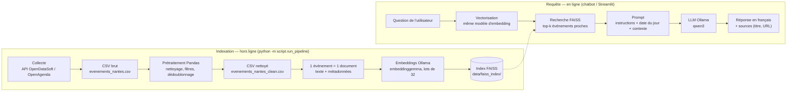

# OCR - Projet 11 : Concevez et déployez un système RAG

*Novembre 2026*

## Contexte du projet

### Entreprise

L'entreprise **Puls-Events** propose une plateforme web qui permet aux utilisateurs de découvrir et de suivre des événements culturels en temps réel.

### Projet

| Avant | Maintenant |
| --- | --- |
| L'utilisateur trouve les événements à l'aide de filtres (lieu, période). | L'utilisateur reçoit des recommandations personnalisées via un **chatbot**, soutenu par un **RAG** (*Retrieval-Augmented Generation*). |

## Objectifs

En tant que **Data Engineer**, réaliser un **POC** (preuve de concept) qui exploite des documents pour répondre à des questions en langage naturel.

**Comment faire chercher une IA dans des documents internes ?**
Un LLM seul ne connaît pas les événements de Puls-Events et peut inventer des réponses. Le RAG procède en deux temps :

1. **Retrieval (recherche)** : on retrouve les événements les plus proches de la question dans une base de données vectorielle.
2. **Generation (génération)** : on transmet ces événements au LLM comme contexte, et il rédige une réponse fondée uniquement sur eux.

**Base de données vectorielle** : une base qui stocke chaque document sous la forme d'un vecteur (une liste de nombres qui représente son sens). Deux textes au sens proche ont des vecteurs proches. On peut donc rechercher par **similarité sémantique** plutôt que par mots-clés : « un spectacle pour enfants ce week-end » retrouve un événement « Marionnettes en famille, samedi », même sans mot commun.

Le POC couvre les événements de **Nantes**, récupérés depuis **OpenAgenda** via l'API OpenDataSoft.

## Structure du projet

```text
projet_11/
├── .github/
│   └── workflows/
│       └── ci.yml                  # Intégration continue : lance pytest à chaque push / PR
├── data/
│   ├── evenements_nantes.csv       # Événements bruts récupérés depuis l'API
│   ├── evenements_nantes_clean.csv # Événements nettoyés (entrée de l'indexation)
│   └── faiss_index/                # Index vectoriel utilisé par le chatbot
│       ├── index.faiss             #   vecteurs
│       └── index.pkl               #   textes et métadonnées des documents
├── script/
│   ├── api_opendatasoft.py         # 1. Collecte paginée des événements
│   ├── preprocessing.py            # 2. Nettoyage, normalisation, filtrage, dédoublonnage
│   ├── embeddings.py               # 3. Création des documents, vectorisation, index FAISS
│   ├── run_pipeline.py             # Enchaîne les étapes 1 → 2 → 3
│   ├── chatbot.py                  # Chaîne RAG : recherche FAISS + génération Ollama (terminal)
│   └── read_index.py               # Inspection de l'index (nombre de vecteurs, dimension, exemples)
├── tests/
│   ├── test_data.py                # Qualité du CSV nettoyé
│   ├── test_preprocessing.py       # Règles de prétraitement
│   └── test_embeddings.py          # Création des documents et de l'index FAISS
├── app.py                          # Interface Streamlit du chatbot
├── config.py                       # Chemins, ville, période, paramètres API et modèles
├── check_env.py                    # Vérifie que les dépendances s'importent correctement
├── requirements.txt                # Dépendances Python
├── .env                            # Variables locales (non versionné)
└── README.md
```

## Logigramme



**Lecture du schéma**

- **Indexation (hors ligne)** : les événements sont collectés, nettoyés puis transformés en vecteurs. Chaque événement forme un seul document (titre, description, conditions, lieu, adresse, ville, âge conseillé, dates). Les documents ne sont pas découpés en morceaux.
- **Requête (en ligne)** : la question est vectorisée avec le même modèle que les documents, ce qui rend leurs vecteurs comparables. FAISS renvoie les *k* événements les plus proches. Le LLM rédige la réponse à partir de ce contexte uniquement.
- **L'index ne rédige rien** : il retrouve les documents. C'est le LLM qui écrit la réponse.

## Choix technologiques

| Besoin | Choix | Pourquoi |
| --- | --- | --- |
| Source de données | **API OpenDataSoft** (jeu `evenements-publics-openagenda`) | Données publiques, paginées, filtrables par ville et par date. |
| Format intermédiaire | **CSV** | Simple à inspecter et à réutiliser entre les étapes. Le brut reste séparé du nettoyé. |
| Transformations | **Pandas** | Validation, normalisation, filtrage et dédoublonnage de données tabulaires. |
| Découpage | **1 événement = 1 document** | Les informations d'un événement restent ensemble. Les métadonnées rattachent chaque résultat à sa source. |
| Embeddings | **Ollama + `embeddinggemma`** (dimension 768) | Tourne en local : aucune donnée envoyée à l'extérieur, aucun coût au token. |
| LLM de génération | **Ollama + `qwen3:1.7b`** (par défaut) | Petit modèle local, rapide sur CPU, bon en français. Configurable (`qwen3:4b`, `qwen3:8b`…). |
| Base vectorielle | **FAISS** (`faiss-cpu`) | Bibliothèque locale, sans service à déployer. Suffisante pour environ 10 000 événements. |
| Orchestration | **LangChain** (`langchain-community`, `langchain-ollama`) | Chargement de l'index, retriever, prompt, chaîne `prompt | llm | parser`. |
| Interface | **Streamlit** | Chat web en quelques lignes, avec réglage du modèle et affichage des temps de réponse. |
| Qualité | **pytest** + **GitHub Actions** | Tests à chaque push et pull request sur `main`. |

### Embeddings : local ou Cloud ?

| Type de solution | Exemples | Sécurité des données | Coût (10 000 documents) |
| --- | --- | --- | --- |
| Local / CPU | Sentence Transformers | Maximale (100 % local) | 0 € / token |
| **Moteur local (retenu)** | **Ollama** | **Maximale (100 % local)** | **0 € / token** (matériel à prévoir) |
| API Cloud SaaS | Mistral, GPT-4o, Gemini | Moyenne à forte (RGPD UE / Cloud Act US) | 100 à 400 € / mois |
| Auto-hébergement Cloud | LLaMA 70B, Mixtral 8x22B via vLLM | Excellente (infrastructure maîtrisée) | 2 000 à 5 000 € / mois |

Le POC a d'abord été écrit avec l'API Mistral, puis basculé sur Ollama. Un index créé avec un modèle d'embedding ne fonctionne pas avec un autre : il faut le reconstruire.

### Base vectorielle

| Solution | Hébergement | Passage à l'échelle | Données locales |
| --- | --- | --- | --- |
| **FAISS (retenu)** | Local, dans l'application Python | Limité par la machine | Oui |
| Weaviate | Local ou Cloud | Adapté à la montée en charge, filtres | Oui si auto-hébergé |
| Milvus | Local ou Cloud, distribué | Très grands volumes | Oui si auto-hébergé |
| Pinecone | Cloud managé | Adapté à la montée en charge | Non |

### Algorithme d'indexation FAISS

| Algorithme | Principe | Compromis |
| --- | --- | --- |
| **IndexFlat (retenu)** | Compare la question à tous les vecteurs. | Résultat exact. Plus lent quand le volume augmente. |
| IndexIVFFlat | Répartit les vecteurs en groupes et n'explore que les plus proches. | Plus rapide, mais peut manquer le meilleur résultat. |
| IndexHNSW | Parcourt un graphe de voisins proches. | Très rapide, mais plus gourmand en mémoire. |

Pour environ 10 000 événements, la recherche exhaustive reste rapide. Elle ne manque jamais le résultat le plus proche.

### Prompt du chatbot

Le prompt système impose au modèle de :

- répondre en français à partir **uniquement** des événements fournis ;
- interpréter les dates relatives (« aujourd'hui », « ce week-end ») à partir de la **date du jour** (fuseau Europe/Paris), injectée à chaque question ;
- ne pas recommander d'événement passé ou incompatible avec la période demandée ;
- dire qu'il ne sait pas plutôt que d'inventer.

La température est fixée à 0,2 pour limiter les réponses fantaisistes.

## Tests

```powershell
python -m pytest tests/ -v
```

| Fichier | Ce qui est vérifié |
| --- | --- |
| `tests/test_data.py` | Le CSV nettoyé contient les colonnes requises, des titres, des dates valides, des événements dans la période attendue et dans la bonne ville, et des `uid` présents et uniques. |
| `tests/test_preprocessing.py` | Le nettoyage du texte, la journalisation des événements écartés et le rejet d'un fichier sans les colonnes requises. |
| `tests/test_embeddings.py` | Un document est créé par ligne du CSV. L'index FAISS est créé avec un faux modèle d'embedding, donc sans Ollama. |
| `tests/test_embeddings.py` (intégration) | Ollama renvoie des vecteurs de dimension constante. Ces tests sont ignorés par défaut. |

Pour lancer les tests d'intégration avec Ollama démarré et `embeddinggemma` téléchargé :

```powershell
$env:RUN_OLLAMA_INTEGRATION = "1"
python -m pytest tests/test_embeddings.py -v
```

Les tests tournent aussi automatiquement sur GitHub Actions (Ubuntu, Python 3.13) à chaque push et pull request vers `main`. Un test qui échoue bloque la fusion.

## Indicateurs de performances

### Données et index

| Indicateur | Valeur |
| --- | --- |
| Événements récupérés depuis l'API | 10 000 (plafond configuré dans `config.py`) |
| Événements conservés après prétraitement | 9 998 |
| Doublons et dates invalides restants | 0 |
| Vecteurs dans l'index FAISS Ollama | 9 998 |
| Dimension des vecteurs | 768 (`embeddinggemma`) |

Pour vérifier ces valeurs sur votre index :

```powershell
python -m script.read_index
```

### Temps de réponse

L'interface Streamlit affiche sous chaque réponse :

- **Recherche** : vectorisation de la question et recherche FAISS ;
- **Réponse Ollama** : temps de génération du LLM ;
- **Total**.

Exemple mesuré sur la machine de développement, avec `qwen3:1.7b`, pour la question « Un concert ce week-end ? » :

| Étape | Temps |
| --- | --- |
| Recherche (embedding + FAISS) | 3,8 s |
| Génération Ollama | 72,3 s |
| Total | 76,1 s |

La génération représente l'essentiel du temps. Elle dépend du modèle choisi et de la machine (CPU ou GPU). Un modèle plus petit (`qwen3:1.7b`) répond plus vite qu'un modèle plus grand (`qwen3:8b`), mais avec des réponses moins riches.

### Qualité des réponses (à mesurer)

| Indicateur | Ce qu'il mesure |
| --- | --- |
| Recall@k | Part des événements pertinents retrouvés parmi les *k* premiers résultats. |
| Precision@k | Part des *k* résultats qui sont réellement pertinents. |
| Fidélité | La réponse ne contient que des informations présentes dans les événements fournis. |
| Respect des dates | Aucun événement passé ou hors période n'est recommandé. |

Ces indicateurs nécessitent un jeu de questions types annoté. Il n'existe pas encore dans le POC.

## Limites du projet

| Limite | Piste d'amélioration |
| --- | --- |
| **Pas d'évaluation de la qualité** : la pertinence des résultats n'a pas été mesurée sur un jeu de questions métier. | Écrire une vingtaine de questions types avec les événements attendus, puis calculer Recall@k et Precision@k. Utiliser un LLM « juge » pour noter la fidélité des réponses (ex. RAGAS). |
| **Dates mal comprises par la recherche** : FAISS cherche par sens, pas par date. Une question comme « ce week-end » peut faire remonter des événements à d'autres dates. | Extraire la période de la question (« ce week-end » → samedi-dimanche), puis filtrer sur les métadonnées `start_date` / `end_date` avant ou après la recherche FAISS. |
| **Couverture limitée** : une seule ville (Nantes) et un plafond de 10 000 événements. | Rendre la ville paramétrable dans l'interface, ajouter `location_city` en filtre de métadonnées et augmenter `API_MAX_RECORDS`. Au-delà de 100 000 événements, passer à un index `IndexHNSW` ou à une base comme Weaviate ou Milvus. |
| **Données figées** : l'index n'est pas mis à jour automatiquement. Le reconstruire oblige à recalculer tous les embeddings. | Planifier la collecte chaque nuit (cron, GitHub Actions). Ne vectoriser que les nouveaux événements et les ajouter avec `add_documents`. Supprimer les événements passés grâce à leur `uid`. |
| **Dépendance au matériel** : les temps de réponse dépendent de la machine. Sans GPU, la génération reste lente (environ 70 s). | Afficher la réponse au fur et à mesure (streaming), réduire `k`, utiliser un GPU ou un serveur dédié, ou une API Cloud européenne (Mistral) pour la production. |
| **Petit modèle de génération** : `qwen3:1.7b` peut mal suivre les consignes ou se tromper sur les dates (ex. un vendredi annoncé comme « mardi »). | Tester `qwen3:4b` / `qwen3:8b`. Donner le jour de la semaine dans le prompt (« jeudi 12/11/2026 ») et dans le texte des événements. |
| **Pas d'historique de conversation** : chaque question est traitée indépendamment des précédentes. | Transmettre les derniers échanges au prompt (`MessagesPlaceholder` de LangChain) et reformuler la question de suivi avant la recherche. |
| **Maintenance** : `langchain-community` est en cours d'abandon (avertissements de dépréciation). `index.pkl` est chargé avec `pickle`. | Migrer vers les paquets dédiés (`langchain-ollama`, intégration FAISS autonome). Ne charger que des index créés par le projet, et enregistrer dans l'index le modèle d'embedding et la date de création. |

## Configuration de l'environnement

### 1. Environnement Python

Python 3.13 recommandé (version utilisée par la CI).

```powershell
python -m venv .venv
.\.venv\Scripts\Activate.ps1
python -m pip install -r requirements.txt
python check_env.py
```

`check_env.py` vérifie que toutes les bibliothèques s'importent correctement.

### 2. Ollama

Installer Ollama pour Windows depuis https://ollama.com/download, puis télécharger les modèles :

```powershell
ollama pull embeddinggemma
ollama pull qwen3:1.7b
```

`embeddinggemma` vectorise les événements et les questions. `qwen3:1.7b` rédige les réponses.

### 3. Fichier `.env` (facultatif)

Les valeurs par défaut sont définies dans `config.py`. Pour les remplacer, créer un fichier `.env` à la racine :

```text
OLLAMA_BASE_URL=http://localhost:11434
OLLAMA_EMBEDDING_MODEL=embeddinggemma
OLLAMA_CHAT_MODEL=qwen3:1.7b
GEO_CITY=Nantes
GEO_REGION=Pays de la Loire
```

### 4. Construire l'index

Pipeline complet (collecte, prétraitement, indexation) :

```powershell
python -m script.run_pipeline
```

Ou étape par étape :

```powershell
python -m script.api_opendatasoft
python -m script.preprocessing
python -m script.embeddings
```

L'index est enregistré dans `data/faiss_index/`. Il est fourni dans le dépôt : le chatbot peut être lancé sans le reconstruire. Après un changement de modèle d'embedding, il faut le reconstruire.

Pour inspecter l'index sans contacter Ollama :

```powershell
python -m script.read_index --limit 10
```

### 5. Lancer le chatbot

```powershell
# Dans le terminal
python -m script.chatbot

# Dans le navigateur
python -m streamlit run app.py
```

La barre latérale de Streamlit permet de changer le modèle de chat.
