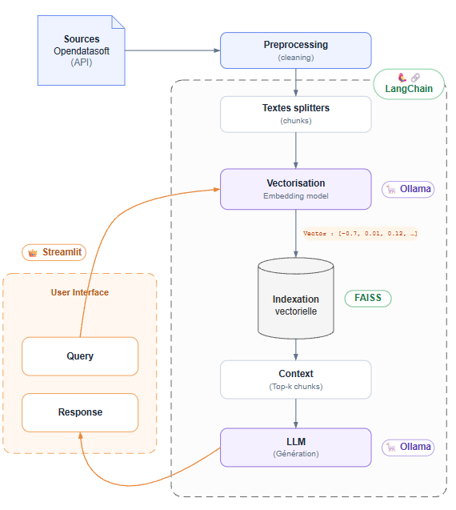

# Rapport du POC — Recherche d'événements à Nantes

*Synthèse technique et recommandations d'architecture — Octobre 2026*

## 1. Objectif

Construire une première chaîne de préparation de données pour rechercher des événements culturels et publics à Nantes.

- Récupérer les événements depuis OpenAgenda via l'API OpenDataSoft.
- Nettoyer les données et harmoniser les informations utiles à la recherche.
- Transformer les événements en vecteurs et les enregistrer dans un index local.
- **Utiliser des recommandations personnalisées via un chatbot appuyé par le RAG.**

## 2. Architecture du système

### 2.1 Schéma de la chaîne RAG



**Lecture du schéma**

- 1 - Collecte des données via l’API OpenDataSoft
- 2 - Prétraitement, nettoyage et standardisation :   Cleaning (nettoyage) : retire les espaces superflus et les données inutilisables, par exemple un événement sans titre. Le texte envoyé au modèle est ainsi plus lisible.  Standardisation : met les champs dans un format cohérent, par exemple en uniformisant les espaces et en nettoyant les champs texte. Les données sont plus régulières à traiter. La standardisation reste volontairement légère pour ne pas modifier le sens des titres ou des descriptions.
- 3 - Vectorisation (modèle d'embedding) :  Deux textes au sens proche ont des vecteurs proches, comme deux points voisins sur une carte.


- **4 - L'indexation (FAISS) :** Il prend tous ces vecteurs de chiffres, les classe et les organise dans une structure ultra-optimisée (qu'on appelle un **index vectoriel**) pour qu'on puisse y faire des recherches par similarité en quelques millisecondes. Les vecteurs sont stockés dans l'index FAISS.

 5 - Interface utilisateur : requête. La question est transformée en vecteur avec le même modèle que les événements. **Le vecteur de requête** est simplement la représentation chiffrée de la question posée. Comme l'index et la question passent par le même modèle, leurs vecteurs sont comparables : les documents proches dans l'espace vectoriel sont les événements pertinents. On cherche ensuite **les vecteurs les plus proches** dans la base. 

6 -  **Faiss est un *moteur de recherche* de vecteurs :** plusieurs méthodes permettent de comparer les vecteurs selon la technique utilisée (clustering, comparaison exhaustive, compression des vecteurs…). Il renvoie les chunks les plus proches, c'est-à-dire les éléments les plus pertinents : les documents correspondants sont proches dans l'espace vectoriel.

7 - Question + événements envoyés au LLM : il génère une réponse en langage naturel 

8 - Un RAG enchaîne beaucoup d'étapes : charger les documents → les découper → calculer les embeddings → les stocker → chercher les plus proches → construire le prompt → appeler le LLM → afficher la réponse.

Chaque outil (Ollama, Mistral, OpenAI, Faiss…) a sa propre façon de s'utiliser, donc il faudrait écrire beaucoup de code de liaison.
LangChain est un framework qui facilite les liaisons entre les outils.

## 3. Choix techniques

- **CSV comme format intermédiaire** — simple à inspecter et à réutiliser entre les étapes. Le fichier brut est conservé séparément du fichier nettoyé.
- **Pandas pour les transformations** — validation, normalisation, filtrage et déduplication de lignes tabulaires.
- **Un événement par document** — les informations d'un même événement restent ensemble, et les métadonnées permettent de rattacher un résultat à sa source. Aucun découpage par caractères n'est appliqué.

### 3.1 Embeddings

Plusieurs approches permettent de transformer les événements en vecteurs. Elles se distinguent par leur mode d'exécution, le niveau de maîtrise des données, les coûts et les ressources nécessaires.

| Type de solution | Rôle et exemples | Sécurité et données | Installation | Coût (10k docs) |
| --- | --- | --- | --- | --- |
| **Local / CPU** | Vectorisation (ex. Sentence Transformers) | Maximale (100 % isolée), tourne dans le code | Package local | 0 € / token (CPU négligeable) |
| **Moteur local + LLM (GPU)** | Génération et embeddings avec de petits modèles (ex. Ollama, LLaMA 8B) | Maximale (100 % isolée), aucune donnée externe | Binaire local | 0 € / token (GPU ~2-3,5 k€) |
| **API Cloud SaaS (UE/US)** | Génération gérée à distance (Mistral, GPT-4o, Gemini) | Moyenne à forte (Mistral UE RGPD / US Cloud Act) | Clé API Cloud | 100 € à 400 € / mois (au token) |
| **Auto-hébergement Cloud** | Modèles géants (LLaMA 70B, Mixtral 8x22B) | Excellente (infrastructure sous contrôle direct) | Docker / vLLM | 2 000 € à 5 000 € / mois (serveur GPU 24/7) |

<aside>
✅

**Choix retenu — Ollama en local.** L'embedding et la génération tournent sur la machine, sans appel à une API externe et sans coût au token. Le POC a d'abord été écrit avec l'API Mistral, puis basculé sur Ollama : `ollama pull qwen3:4b`.

</aside>

### 3.2 Stockage vectoriel

| Solution | Type | Hébergement | Passage à l'échelle | Coût | Données locales |
| --- | --- | --- | --- | --- | --- |
| **FAISS** | Bibliothèque Python de recherche vectorielle | Local (dans l'app Python) | Limité par la machine | Gratuit (infra à financer) | Oui |
| **Weaviate** | Base de données vectorielle avec filtres | Local ou Cloud | Adapté à la montée en charge | Dépend du déploiement | Oui (si auto-hébergé) |
| **Milvus** | Base vectorielle distribuée multi-machines | Local ou Cloud | Conçu pour de très grands volumes | Dépend du déploiement | Oui (si auto-hébergé) |
| **Pinecone** | Base vectorielle managée (Cloud) | Cloud | Adapté à la montée en charge | Dépend de l'offre Cloud | Non |

**Choix retenu — FAISS.** L'index est conservé localement dans les fichiers `index.faiss` et `index.pkl`. La bibliothèque permet des recherches de similarité sans service de base vectorielle externe.

Faiss est idéal pour un POC ou un volume moyen. Faiss charge l'index en RAM pour être rapide. À grande échelle, on passe à une **base vectorielle** dédiée (Qdrant, Milvus, Weaviate, pgvector). Si les données changent beaucoup (nouveaux types d'événements, par exemple), l'index doit être reconstruit.

### 3.3 Algorithme d'indexation FAISS

| Algorithme | Fonctionnement | Avantages | Inconvénients |
| --- | --- | --- | --- |
| **IndexFlatL2** | Compare le vecteur recherché à tous les vecteurs enregistrés, en calculant la distance euclidienne. | Très précis, simple à utiliser. | Recherche plus lente quand le volume augmente. |
| **IndexFlatIP** | Compare les vecteurs avec le produit scalaire (Inner Product). | Très précis, adapté à la similarité cosinus avec des vecteurs normalisés. | Compare tous les vecteurs. |
| **IndexIVFFlat** | Divise les vecteurs en groupes (clusters) et ne recherche que dans certains groupes. | Recherche plus rapide sur de gros volumes. | Peut manquer le meilleur résultat si le bon groupe n'est pas exploré. |
| **IndexHNSW** | Organise les vecteurs dans un graphe pour naviguer rapidement vers les voisins les plus proches. | Très rapide, bonne précision. | Consomme davantage de mémoire. |

<aside>
✅

**Choix retenu — IndexFlatIP.** Pour environ 10 000 événements, la recherche exhaustive reste raisonnable. Elle compare les vecteurs par produit scalaire, ce qui convient à la similarité cosinus lorsque les vecteurs sont normalisés.

</aside>

Concrètement :

- **IndexFlat — comparaison exhaustive.** FAISS compare la question aux 10 000 événements, un par un, calcule leur proximité et retourne les plus proches. Aucun meilleur résultat n'est manqué, mais tout est comparé.
- **IndexIVF — recherche par groupes.** Les événements sont répartis en clusters (musique, sport, culture...). Une question sur les concerts n'explore que les groupes les plus proches : moins de comparaisons, donc plus rapide, mais des événements pertinents peuvent être manqués.
- **IndexHNSW — recherche par graphe.** Chaque vecteur est relié à ses voisins proches et la recherche progresse de proche en proche. Très rapide, mais plus gourmand en mémoire et sans garantie du meilleur résultat absolu.

### 3.4 Chaîne RAG du chatbot

| Partie | Code | Rôle | Précisions |
| --- | --- | --- | --- |
| 1. Configuration | `FAISS.load_local()` | Charge la base vectorielle existante. |  |
| 2. Recherche | `as_retriever()` | Configure la recherche des événements pertinents. |  |
| 3. Modèle IA | `ChatOllama()` | Initialise le LLM local pour générer les réponses. | ajout du prompt pour les dates notamment : INSTRUCTIONS = """
Tu es un assistant qui recommande des \u00e9v\u00e9nements.
La date du jour est {current_date} (fuseau Europe/Paris). Interprete les dates
relatives comme "aujourd'hui" et "ce week-end" a partir de cette date.
R\u00e9ponds en fran\u00e7ais et adapte tes suggestions \u00e0 la demande.
Utilise uniquement les informations des \u00e9v\u00e9nements fournis.
Ne recommande pas un evenement dont les dates sont passees ou incompatibles
avec la periode demandee. Si aucun evenement fourni ne convient, dis-le.
Si les informations ne suffisent pas, dis-le. N'invente pas de d\u00e9tails.
""".strip() |
| 4. Chaîne RAG | `PROMPT | self.llm | StrOutputParser()` | Connecte le prompt au modèle et récupère sa réponse. |  |
| 5. Interaction | `ask()` | Orchestre la recherche et la génération. |  |

### **API OpenDataSoft / OpenAgenda** → CSV brut → **Prétraitement Pandas** → CSV nettoyé → **1 document par événement** → **Embeddings Ollama** → **Index FAISS local**


## 4. Résultats obtenus

| Étape | Résultat |
| --- | --- |
| **Données** | 10 000 événements reçus, 9 841 conservés, 159 écartés (hors ville ou trop anciens). Zéro doublon, zéro date invalide. |
| **Index vectoriel** | `index.faiss` et `index.pkl` générés dans `data/faiss_index/` : 9 841 vecteurs, dimension 1 024. Index daté du 23 octobre 2026. |
| **Tests** | Tests unitaires de création de documents et d'index FAISS simulé réussis. `tests/test_embeddings.py` : 2 tests réussis, 2 tests d'intégration Ollama ignorés. |

## 5. Méthode pour garantir la qualité des données

### Tests et intégration continue

La qualité du pipeline est vérifiée par **12 tests automatisés (pytest)**, répartis sur trois niveaux :

- **Tests unitaires du prétraitement** (`tests/test_preprocessing.py`) :
    - **Présence des colonnes obligatoires** dans la structure des données.
    - **Absence de valeurs nulles ou vides dans les champs obligatoires**, notamment `title_fr` (titre de l'événement).
    - **Validité des dates et cohérence de leur ordre chronologique** (`lastdate_end >= firstdate_begin`).
    - **Vérification des filtres géographiques attendus et suppression des doublons**.
- **Tests de qualité des données** (`tests/test_data.py`). Ils contrôlent le jeu de données réel : présence des colonnes obligatoires, titres renseignés, dates lisibles et cohérentes (début avant fin), identifiants uniques, événements situés à Nantes et dans la période retenue.
- **Tests de la vectorisation** (`tests/test_embeddings.py`). Ils vérifient qu'un document est créé par événement avec ses métadonnées, et que l'index FAISS est bien construit et sauvegardé. Ces tests utilisent un **modèle d'embedding simulé**, ce qui les rend rapides et indépendants d'Ollama. Deux **tests d'intégration**, activés avec `RUN_OLLAMA_INTEGRATION=1`, appellent le vrai modèle local et vérifient qu'il renvoie des vecteurs de dimension constante.

**Résultat : 12 tests réussis sur 12**, en environ 9 secondes avec les tests d'intégration.

Les tests sont exécutés automatiquement par **GitHub Actions** à chaque *push* et à chaque *pull request* sur la branche `main`. Un test en échec bloque la fusion, ce qui empêche d'introduire une régression sans s'en apercevoir. Les tests d'intégration, qui ont besoin d'Ollama, ne tournent qu'en local.

**Test sur la qualité des réponses du chatbot** 

Indicateurs à suivre pour ce RAG :

- **Faithfulness** : pas d'hallucination, la réponse est fidèle aux sources.
- **Pertinence** : la réponse répond vraiment à la question.
- **Recall@k** : parmi les k documents récupérés, trouve-t-on le bon ?

La pertinence des événements retrouvés et l'absence d'hallucination ne sont pas encore testées automatiquement. La prochaine étape serait un jeu de questions de référence évalué à chaque modification.

## 6. Limites du POC

- La qualité sémantique des résultats n'a pas été évaluée sur un jeu de test métier.
- **La qualité des réponses du RAG n'est pas mesurée** avec un outil comme **RAGAS** :
    - *Faithfulness* : la réponse s'appuie-t-elle vraiment sur les documents trouvés, ou le modèle invente-t-il ?
    - *Answer relevancy* : la réponse correspond-elle bien à la question ?
    - *Context precision / recall* : le retriever a-t-il trouvé les bons documents ?
- La reconstruction complète de l'index implique de recalculer tous les embeddings.
- Le plafond de récupération est configuré à 10 000 événements, à adapter si le volume augmente.

## 7. Recommandations pour la suite

- **Priorité 1 — Construire et évaluer la recherche.** Ajouter une fonction de recherche k-NN et mesurer la qualité des résultats (Recall@k / Precision@k) sur des questions types.
- **Priorité 2 — Rendre l'index traçable.** Enregistrer le nom du modèle, la version, la date et la source dans les métadonnées de l'index.
- **Priorité 3 — Améliorer la robustesse.** Gérer les retries API et ajouter des tests sur cas limites (CSV vide, colonnes manquantes).
- **Priorité 4 — Comparer les modèles.** Comparer les modèles d'embedding disponibles sous Ollama et Hugging Face (qualité, temps, coût).
- **Priorité 5 — Préparer la maintenance.** Nettoyer `requirements.txt` et traiter les avertissements de dépréciation (`langchain-community`).

## 8. Commandes utiles

```bash
# Pipeline complet
python -m script.run_pipeline

# Étape par étape
python -m script.api_opendatasoft
python -m script.preprocessing
python -m script.embeddings

# Tests locaux
python -m pytest tests/ -v
```